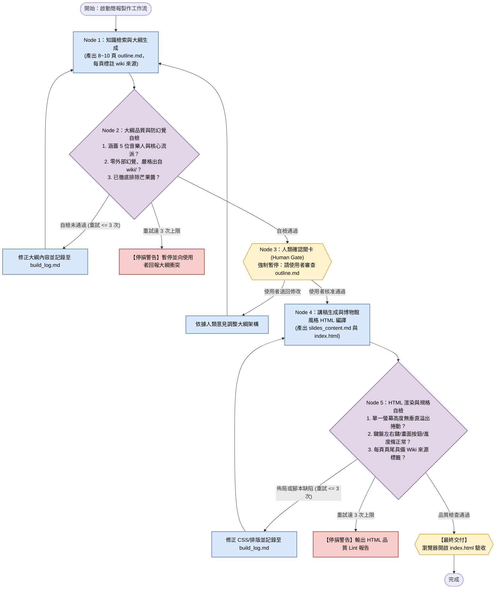

# AGENTS.md - LLM Wiki 維護手冊與架構規範

本手冊規範「經典與現代流行音樂流派與代表音樂人」LLM Wiki 知識庫的架構、維護原則、檔案命名、雙向連結及各項自動化作業流程。
本 Wiki 旨在作為**唯一知識真實來源（Single Source of Truth）**，專為未來製作給音樂新手觀看的**教學用 HTML 簡報**而設計。

---

## 1. 核心理念與三層架構 (Three-Layer Architecture)

依循 Andrej Karpathy 的 LLM Wiki 模式，本知識庫分為三層：

1. **原始資料層 (`raw/`)**：
   - 存放使用者提供的原始樂評、書籍摘錄、音樂人訪談、介紹文章等。
   - **原則**：**唯讀且不可篡改（Immutable）**。LLM 只能讀取原始資料，絕不直接修改其中的內容。
2. **結構化知識庫 (`wiki/`)**：
   - LLM 全權擁有的核心資產，由高度結構化、互相交叉引用的 Markdown 條目組成。
   - 知識只在此處沉澱與擴充。每次新增資料時，LLM 負責將零散知識綜合成完整的條目網絡。
3. **規範與綱領 (`AGENTS.md`)**：
   - 即本檔案，定義 LLM 維護知識庫的規則、結構、頁面模板與標準工作流程（Workflows）。

---

## 2. 目錄架構與職責劃分

專案目錄結構如下：

```text
museum-of-sound-llm-wiki/
├── AGENTS.md                  # LLM 核心規範與維護手冊
├── index.md                   # 內容總索引（分類檢索目錄 + 單行新手摘要）
├── log.md                     # 時間異動日誌（Append-only，記錄所有操作）
├── raw/                       # 原始資料區（不可變）
│   └── YYYY-MM-DD-<slug>.md
└── wiki/                      # 結構化知識庫
    ├── genres/                # 曲風流派概念頁（如 rock.md, city-pop.md）
    ├── artists/               # 音樂人條目頁（如 michael-jackson.md）
    ├── sources/               # 單篇來源摘要（如 2026-11-16-origins-of-funk.md）
    └── guides/                # 新手教學指南、流派演變圖譜、簡報草稿
```

### 各資料夾詳細職責：
- **`raw/`**：原始檔統一命名為 `YYYY-MM-DD-<slug>.md`。保留完整原文，包含外部連結與出處。
- **`wiki/genres/`**：音樂流派頁面。強調「新手友善的聽覺特徵」、「發源年代與背景」、「關鍵樂器與節奏」、「代表性音樂人與名曲」。
- **`wiki/artists/`**：代表性音樂人/樂團頁面。包含「流派定位」、「音樂生涯核心階段」、「招牌風格與代表作」、「給新手的推薦入門歌單」。
- **`wiki/sources/`**：對每份 `raw/` 檔案的結構化萃取摘要，註明關鍵洞察、提及的音樂人/曲風，以及對既有知識庫的補充或修正點。
- **`wiki/guides/`**：綜合性主題文章，例如「流行音樂百年演進樹狀圖」、「初學者 10 分鐘聽懂 R&B」或預計轉換成 HTML 簡報的結構大綱。

---

## 3. 檔案命名與雙向連結規範

### 3.1 檔案命名規則
- **一律使用英文小寫與連字號（kebab-case）**，避免使用空格、特殊字元或純中文檔名，確保跨平台（Windows/macOS/Linux/Git）與 HTML 轉換環境的一致性。
- 範例：
  - 曲風：`wiki/genres/synth-pop.md`, `wiki/genres/r-and-b.md`
  - 音樂人：`wiki/artists/the-beatles.md`, `wiki/artists/tatsuro-yamashita.md`
  - 原始文獻：`raw/2026-11-16-pitchfork-synthpop-history.md`
  - 文獻摘要：`wiki/sources/pitchfork-synthpop-history.md`
  - 新手教學：`wiki/guides/beginner-listening-framework.md`

### 3.2 雙向連結格式
- **統一使用標準 Markdown 相對路徑連結**：`[顯示名稱](相對路徑)`。
- 相對路徑範例：
  - 在 `wiki/genres/city-pop.md` 引用音樂人：`[山下達郎](../artists/tatsuro-yamashita.md)`
  - 在 `wiki/artists/tatsuro-yamashita.md` 引用曲風：`[城市流行（City Pop）](../genres/city-pop.md)`
  - 在 `index.md` 引用條目：`[城市流行（City Pop）](wiki/genres/city-pop.md)`
- **禁止使用** Obsidian 專屬的 `[[wiki-link]]`，以確保所有 Markdown 頁面能直接被標準靜態網站產生器、HTML 簡報工具（如 Marp、Reveal.js 或前端腳本）無縫解析。

---

## 4. 條目格式與 YAML Frontmatter 模板

所有 `wiki/` 頁面皆須包含標準的 YAML Frontmatter，以便程式檢索與分類。

### 4.1 曲風頁面模板 (`wiki/genres/<genre-slug>.md`)
```markdown
---
title: "中文流派名（英文流派名）"
category: "genre"
era: "興起年代（如：1970s）"
origins: ["源頭流派連結"]
subgenres: ["子流派連結"]
tags: ["流派標籤"]
updated: "YYYY-MM-DD"
---

# 中文流派名（英文流派名）

> **一句話給新手的定義**：用最生活化、無門檻的比喻或聽覺描述解釋此曲風。

## 1. 核心聽覺特徵 (Sonic Characteristics)
- **節奏與律動**：
- **核心樂器**：
- **唱腔與編曲特色**：

## 2. 歷史起源與文化背景 (History & Context)
- 起源背景與代表性場景：
- 演進脈絡：

## 3. 代表音樂人 (Representative Artists)
- [音樂人名](../artists/artist-slug.md) - 代表性成就與貢獻

## 4. 新手入門 3 首必聽神曲 (Beginner Starter Pack)
1. **《曲名》** - 音樂人（發行年份）：聽點說明。
2. **《曲名》** - 音樂人（發行年份）：聽點說明。
3. **《曲名》** - 音樂人（發行年份）：聽點說明。

## 5. 關聯流派脈絡 (Connections)
- **前身/啟發自**：[流派名](parent-genre.md)
- **後續催生/衍生出**：[流派名](child-genre.md)

## 6. 資料來源 (Sources)
- [文獻名稱](../sources/source-slug.md)
```

### 4.2 音樂人頁面模板 (`wiki/artists/<artist-slug>.md`)
```markdown
---
title: "音樂人名（英文名/原文名）"
category: "artist"
active_period: "活躍年代（如：1980s - 至今）"
primary_genres: ["主要流派連結"]
nationality: "國籍"
tags: ["歌手", "製作人", "標籤"]
updated: "YYYY-MM-DD"
---

# 音樂人名（英文名/原文名）

> **新手定位標籤**：如「流行樂之王」、「City Pop 教父」等一目了然的定位。

## 1. 藝術家簡介 (Overview)
以通俗易懂的語言介紹其歷史地位與標誌性貢獻。

## 2. 代表曲風與音樂風格 (Musical Style)
- 主要深耕於 [曲風名](../genres/genre-slug.md)。
- 標誌性聲響與個人突破點：

## 3. 關鍵生涯里程碑與重要作品 (Milestones & Albums)
- **經典專輯/轉捩點**：《專輯名》（年份）
- **歷史影響力**：

## 4. 新手入門指南 (Where to Start)
- **必聽代表作**：
  1. 《曲名》：聽覺焦點（如吉他獨奏、標誌性滑音、唱腔）。
  2. 《曲名》：聽覺焦點。
- **欣賞門道小提示**：

## 5. 合作與相互影響 (Network)
- 影響的後輩：
- 受其影響的前輩：

## 6. 資料來源 (Sources)
- [文獻名稱](../sources/source-slug.md)
```

---

## 5. 核心維護流程 (Workflows)

### 5.1 攝入流程（Ingest Workflow - 全自動執行型）
當使用者提供新的文章、訪談或樂評文本時，LLM 必須嚴格按照以下六步驟自動執行：

1. **原始文檔存檔 (`raw/`)**：
   - 命名為 `raw/YYYY-MM-DD-<slug>.md`。
   - 將使用者的輸入完整存檔，保留原文完整細節，絕不做破壞性刪減。
2. **提取文獻摘要 (`wiki/sources/`)**：
   - 建立 `wiki/sources/<slug>.md`。
   - 提煉核心觀點、提到的所有音樂人、涉及曲風及新舊知識的差異點。
3. **知識網狀整合 (`wiki/genres/` & `wiki/artists/`)**：
   - 比對知識庫既有條目：
     - 若提到的音樂人或曲風已有條目，依據新資料**補充並修正**內容（例如加入新的代表曲、補充風格演變分析）。
     - 若尚未存在條目，則依據模板**建立全新條目**。
   - 建立雙向 Markdown 相對連結，確保流派與音樂人間互相串接。
4. **更新總索引 (`index.md`)**：
   - 將新建立或大幅異動的條目登錄至 `index.md`。
   - 保持每條條目均附有一句面向音樂新手的簡明介紹。
5. **登記異動日誌 (`log.md`)**：
   - 以 Append-only 方式追加記錄，格式統一為：
     ```markdown
     ## [YYYY-MM-DD] ingest | 文獻標題
     - **原始檔案**：`raw/YYYY-MM-DD-<slug>.md`
     - **來源摘要**：`wiki/sources/<slug>.md`
     - **建立/更新條目**：
       - `wiki/genres/<genre>.md` (更新/建立)
       - `wiki/artists/<artist>.md` (更新/建立)
     - **核心提煉摘要**：條列 2~3 點本次攝入的新知識。
     ```
6. **回報更新報告 (Report)**：
   - 在交談中清楚回報本次自動化作業完成的工作清單，包含新增的檔案路徑、更新的條目與關鍵心得。

---

### 5.2 查詢與提煉流程（Query Workflow）
- 使用者詢問音樂概念、流派比較或代表人物時，LLM **以 `wiki/` 目錄中的條目為唯一知識基礎**進行綜合回答。
- 若回答產生了具有長期價值的橫向對比、新手教學框架或演進脈絡，LLM 應主動將該回答沉澱至 `wiki/guides/<slug>.md`，並同步更新 `index.md` 與 `log.md`。

---

### 5.3 知識庫健康檢查流程（Lint Workflow）
定期執行以下檢查，確保知識庫的純度與健康度：
- **斷鏈檢查 (Broken Links)**：確認所有 Markdown 相對連結目標檔案均存在。
- **孤島頁面 (Orphan Pages)**：檢查是否有無任何入站連結（Inbound link）的邊緣頁面。
- **觀點矛盾 (Contradictions)**：檢視不同來源引述的年份或流派起源是否有衝突，若有衝突應在條目中並陳註記。
- **知識缺口 (Knowledge Gaps)**：指出條目中頻繁被提及但尚未建立獨立頁面的重要曲風或音樂人，建議使用者補充資料。

---

### 5.4 HTML 簡報轉譯與 Graph 工作流程 (Presentation Export Graph Workflow)

本流程將 `wiki/` 結構化知識轉譯為音樂新手教學專用之 `index.html` 簡報，採嚴格之 5 節點 Graph 狀態機工作流程，包含自我檢查迴圈（Loops）與人類確認關卡（Human-in-the-loop Gate）。所有檢查日誌統一記錄於 `build_log.md`。



#### 各節點規範與驗證指標 (Node Specifications)
1. **Node 1（知識檢索與大綱生成）**：
   - 讀取 `wiki/index.md` 與相關概念頁（5 位音樂人：Beyond、陶喆、鄧紫棋、Queen、周杰倫；3 大核心曲風：搖滾樂、R&B/靈魂樂、華語流行）。
   - 規劃 8～10 頁教學大綱（`outline.md`），每一頁都必須標註 `[資料來源: wiki/xxx.md]`。
2. **Node 2（大綱品質與防幻覺自檢 Loop）**：
   - 審查項：
     1. 5 位音樂人與核心曲風是否都有涵蓋？
     2. 是否嚴格限定使用 `wiki/` 內容、無外部捏造資訊？
     3. 是否已徹底排除芒果醬？
   - 停損機制：未通過則退回 Node 1，記錄細節於 `build_log.md`，**最多重試 3 次**。
3. **Node 3（人類確認關卡 Human Gate）**：
   - **強制暫停點**：大綱自檢通過後，必須暫停輸出向使用者完整展示 `outline.md`，等待使用者確認同意後方可進入 Node 4。
4. **Node 4（逐頁講稿與博物館風格 HTML 編譯）**：
   - 依據確認後的大綱生成 `slides_content.md`，再編譯為套用《聲音博物館 Museum of Sound》視覺風格的 `index.html`。
5. **Node 5（HTML 渲染、路徑與內容一致性自檢 Loop）**：
   - 審查項：
     1. 排版是否超出單一螢幕高度（`height: 100vh; overflow: hidden;`，完全避免垂直捲動條）？
     2. 鍵盤左右鍵（`←` / `→` / `Space`）與畫面按鈕翻頁、動態進度條功能是否正常？
     3. 每頁頁尾是否清楚標註引用的 `wiki/` 檔案路徑？
     4. **強制全文關鍵字與大綱一致性掃描 (Consistency & Banned Words Scan)**：
        - (a) **大綱同步性**：必須讀取最終產出的 `index.html`，確認總頁數與標題必須與最新版 `outline.md` 100% 一致（完整包含周杰倫，總頁數精準為 9 頁）。
        - (b) **禁詞零容忍**：全篇掃描「芒果醬」與「mango-jump」字樣，出現次數必須為 0；若發現任何殘留或頁面不符，立即判定不合格，直接退回 Node 4 執行強制覆寫與重新編譯！
   - 停損機制：若有錯誤自動修正並記錄於 `build_log.md`，**最多重試 3 次**。

#### 《聲音博物館》視覺規格與展廳標準 (Museum of Sound Specification)
- **視覺定位**：聲音博物館展廳典藏風（Museum Vinyl & Walnut Archive）。
- **色彩系統**：
  - 展廳深色背景（`#111317` / `#161922`）
  - 黑膠典藏金與暖色點綴（`#D4AF37` / `#C5A059` / `#E5B567`）
  - 深胡桃木卡片邊框與陰影（`#2A221B` / `#3D2E24`）
- **展區標籤對應 (Exhibition Halls)**：
  - `HALL 01｜香港與華語經典`（Beyond、鄧紫棋）
  - `HALL 02｜世界流行音樂`（Queen 皇后合唱團）
  - `HALL 04｜華語創作與 R&B`（陶喆、周杰倫）
- **單屏無捲動保證**：嚴格適應視口（Single-viewport height），文字排版精煉卡片化，免滾輪捲動。
- **知識溯源標籤**：頁尾渲染半透明膠囊標籤（如 `📖 聲音博物館典藏溯源：wiki/artists/jay-chou.md`）。

